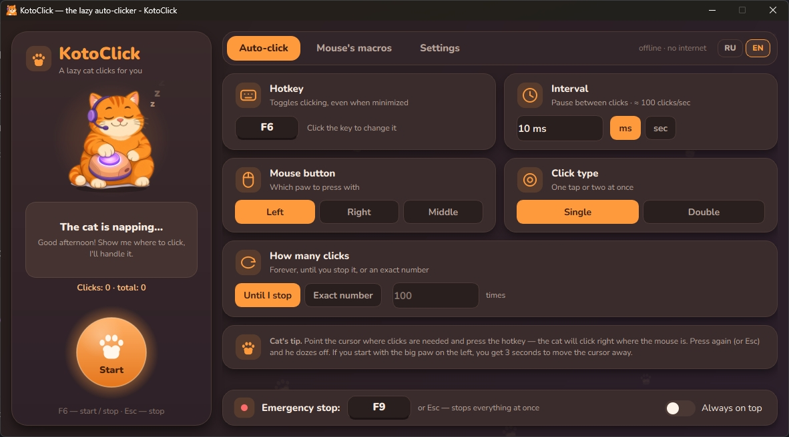

# 🐱 KotoClick / 🌐 [English](README.md) | 🇷🇺 [Русский](README.ru.md)

**KotoClick** is an auto-clicker for Windows with a lazy orange cat that clicks for you, and a little mouse helper that records your actions into macros. The program works completely offline and is written entirely in Python by a neural network and the crazy enthusiasm of young independent developers.

> Screenshots: 

## Download

**[⬇ Download KotoClick.exe](https://github.com/NOMBER/KotoClick/releases)** — ready-to-use program for Windows, single file, no Python required.

**File verification.** The SHA-256 checksum is listed in the release description. Open PowerShell in the folder with the downloaded file and compare:

```powershell
Get-FileHash .\KotoClick.exe -Algorithm SHA256
```

**If Windows warns you.** `KotoClick.exe` is not digitally signed and is built with PyInstaller, and the program uses global keyboard and mouse hooks (`pynput`). Therefore SmartScreen (“Windows protected your PC”) or antivirus software may be suspicious. If the checksum matches and you trust the file: “More info” → “Run anyway”.

If you don’t want to run someone else’s `.exe` — run the program from source (`run.bat`) or build your own `KotoClick.exe` (`build.bat`), see [“Installation and running”](#installation-and-running).

## Features

**Auto-click**
- Hotkey turns clicks on and off at the cursor position (default `F6`, reassignable in the window).
- Interval in milliseconds or seconds, left / right / middle mouse button, single or double click, infinitely or a set number of times.
- `Esc` or `F9` — “emergency stop” that stops everything immediately.

**Mouse macros**
- Record clicks (`F7`) and replay in a loop or a set number of times (`F8`). Mouse movements and key presses are recorded according to checkboxes; keys are not recorded by default.
- Macros can hold mouse buttons, drag & drop, and scroll the wheel: a quick press stays a normal click, a long press or one with movement is recorded as “Hold … button” → path → “Release … button”, and consecutive wheel clicks are combined into a single “Scroll ×N” step. After stopping, no button remains held.
- Macro steps can be edited in a table: pauses, coordinates, adding and deleting steps.
- Macros are stored in the `macros` folder inside the program folder.
- Switch between macros via a dropdown list. Changes are saved automatically.
- In the “More” menu: rename, copy, delete (with confirmation), import, export, open folder.

**Cat and its reactions**
- Sleeps with eyes closed when nothing is happening, and opens them when clicking.
- The headset on its head bounces on every click.
- If you click very fast for a long time, the “vibey disco” turns on. Animations and the disco can be disabled in “Settings”.
- “Talkative cat” mode: short cute phrases in a speech bubble. Enabled by default, can be disabled in “Settings”.

**Russian and English**
- RU | EN switcher in the window; the language changes immediately, without restart.
- Cat phrases are in `kotoclick/phrases.py` as a dictionary `PHRASES[situation]["ru" | "en"]`. English phrases are not a literal translation, but the same mood in English. They can be edited and extended.

**Sounds**
- Countdown “beep-beep-beep” before recording, meow on recording start, recording end sound, macro start sound, and quiet ticks during recording.
- Each sound can be enabled or disabled, previewed with the ▶ button, replaced with your own file (“Custom sound…”), and reset to default.
- Custom sounds: WAV, as well as MP3, OGG, M4A, AAC and FLAC (requires the `PySide6-Addons` package). Overall volume is controlled by a slider; long files can be trimmed to 5 seconds right in the interface.
- If a file fails to play, the cat will say so and the program will play the default sound.

## Requirements

- Windows OS, tested on 10 and 11.
- Some version of Python.
- Libraries from `requirements.txt` (downloaded automatically):
  - `PySide6-Essentials` — window and interface;
  - `PySide6-Addons` — needed for MP3, OGG, M4A, AAC, FLAC in “Custom sounds” (without it the program still runs, but custom sounds are WAV only);
  - `pynput` — hotkeys, clicks and mouse recording.

## Installation and running

1. Install Python from [python.org](https://www.python.org/downloads/) and check “Add python.exe to PATH” during installation.
2. Download or clone the repository:
   ```
   git clone https://github.com/NOMBER/KotoClick.git
   ```
3. Double-click `run.bat`. On the first run it will create a `.venv` environment in the project folder, install dependencies from `requirements.txt`, and then launch the program.

Or manually:
```
python -m venv .venv
.venv\Scripts\pip install -r requirements.txt
.venv\Scripts\python main.py
```

### Building the .exe

Run `build.bat`: it will create `.venv`, install dependencies and PyInstaller (version 6 or newer), and build `KotoClick.exe` right in the project folder, next to `build.bat` (old `Kotoklik.exe` / `Kotoklik.spec` are deleted after a successful build).

> Antivirus software may false-positive on an `.exe` built with PyInstaller, because the program uses global keyboard and mouse hooks (`pynput`). Therefore it is recommended to run from source or build the `.exe` yourself.

## Security and privacy

- There are no network calls, registry writes, or autostart in the code.
- Recorded macros, including key presses, are stored only locally in `.json` files. Do not enter passwords while recording with the “Record keys” checkbox enabled.
- The only link is to my personal Telegram bot, and it opens only on click.
- Some games with anti-cheat may block auto-clickers.
- Use the program wisely and mindfully, dear friends.

## Project structure

```
main.py                 — entry point
run.bat / build.bat     — run from source / build .exe
requirements.txt        — dependencies
kotoclick/
  engine.py             — auto-click, replay and recording
  hotkeys.py            — global hotkeys
  macro.py, library.py  — macro format and library in the macros folder
  settings.py, paths.py — settings and paths
  sounds.py             — sounds, custom files, volume
  reactions.py          — click frequency and “disco”
  phrases.py            — cat phrases (ru / en)
  promo.py              — schedule of the message about the bot
  i18n.py               — interface texts RU / EN
  ui/                   — window, theme, widgets, cat
assets/                 — images, icon, font, sounds
tests/                  — tests
tools/                  — helper scripts (sounds, images, layout check)
```

## License

This project is distributed under the GPL v3 license.
What this means for users:
- Authorship: Attribution and license notices must be preserved.
- Freedom: The code may be used, modified, and distributed free of charge.
- Copyleft: Any modifications and projects based on this code must also be made available under the GPL v3.

The Nunito font in `assets/fonts/` is distributed under the OFL license; the license text is next to it (`FONT_LICENSE.txt`).

## Contacts

- Telegram bot for downloading videos: [@DownGrabBot](https://t.me/DownGrabBot?start=KotoClick)

- [kotoclick.github.io](https://kotoclick.github.io)

- [NomberProjects](https://NomberProjects.github.io)
