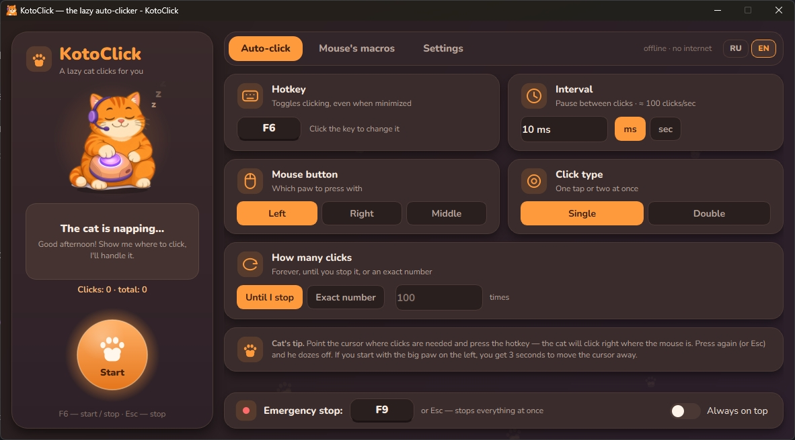

# 🐱 КотоКлик | 🌐 [English](README.md) | 🇷🇺 [Русский](README.ru.md)

**КотоКлик** — автокликер для Windows с рыжим ленивым котиком, который кликает за тебя, и мышкой-помощницей, которая записывает твои действия в макросы. Программа работает абсолютно без интернета и целиком написана на Python с помощью нейросети и сумасшедшего энтузиазма молодых независимых разработчиков.

> Скриншоты: 

## Скачать

**[⬇ Скачать KotoClick.exe](https://github.com/NOMBER/KotoClick/releases)** — готовая программа для Windows, один файл, Python не нужен.

**Проверка файла.** Контрольная сумма SHA-256 указана в описании релиза.
Открой PowerShell в папке со скачанным файлом и сравни:

```powershell
Get-FileHash .\KotoClick.exe -Algorithm SHA256
```

**Если Windows предупреждает.** `KotoClick.exe` не подписан цифровой подписью и собран PyInstaller, а программа использует глобальные хуки клавиатуры и мыши (`pynput`). Поэтому SmartScreen («Система Windows защитила ваш компьютер») или антивирус могут насторожиться. Если сумма совпала и ты доверяешь файлу: «Подробнее» → «Выполнить в любом случае».

Не хочешь запускать чужой `.exe` — запусти программу из исходников (`run.bat`) или собери свой `KotoClick.exe` (`build.bat`), см. [«Установка и запуск»](#установка-и-запуск).

## Возможности

**Автоклик**
- Горячая клавиша включает и выключает клики там, где стоит курсор (по умолчанию `F6`, переназначается в окне).
- Интервал в миллисекундах или секундах, левая / правая / средняя кнопка мыши, одинарный или двойной клик, бесконечно или заданное число раз.
- `Esc` или `F9` — «стоп-кран», который останавливает всё сразу.

**Мышкины макросы**
- Запись кликов (`F7`) и повтор по кругу или заданное число раз (`F8`). Движения мыши и нажатия клавиш записываются по галочкам, клавиши по умолчанию не записываются.
- Макросы умеют зажимать кнопки мыши, перетаскивать (drag & drop) и крутить колёсико: быстрое нажатие остаётся обычным кликом, долгое или с движением записывается как «Зажать … кнопку» → путь → «Отпустить … кнопку», а щелчки колёсика подряд складываются в один шаг «Прокрутка ×N». После стопа ни одна кнопка не остаётся зажатой.
- Шаги макроса можно править в таблице: паузы, координаты, добавление и удаление шагов.
- Макросы хранятся в папке `macros` внутри папки с программой.
- Переключение между макросами через выпадающий список. Изменения сохраняются автоматически.
- В меню «Ещё»: переименовать, копировать, удалить (с подтверждением), импорт, экспорт, открыть папку.

**Котик и его реакции**
- Спит с закрытыми глазами, когда ничего не происходит, и открывает их, когда кликает.
- Гарнитура на голове подпрыгивает на каждый клик.
- Если кликать очень быстро и долго, включается «вайбовая дискотека». Анимации и дискотеку можно отключить в «Настройках».
- Режим «Болтливый котик»: короткие милые фразы в облачке. Включён по умолчанию, отключается в «Настройках».

**Русский и английский**
- Переключатель RU | EN в окне, язык меняется сразу, без перезапуска.
- Фразы котика лежат в `app/phrases.py` в виде словаря `PHRASES[ситуация]["ru" | "en"]`. Английские фразы — не дословный перевод, а то же настроение по-английски. Их можно править и дополнять.

**Звуки**
- Отсчёт «пик-пик-пик» перед записью, мяуканье на старте записи, звук конца записи, звук старта макроса и тихие тики во время записи.
- Каждый звук можно включить или выключить, прослушать кнопкой ▶, заменить своим файлом («Свой звук…») и сбросить на стандартный.
- Свои звуки: WAV, а также MP3, OGG, M4A, AAC и FLAC (для них нужен пакет `PySide6-Addons`). Общая громкость регулируется ползунком, длинные файлы можно обрезать до 5 секунд прямо внутри интерфейса.
- Если файл не удаётся воспроизвести, котик скажет об этом, а программа сыграет стандартный звук.

## Требования

- ОС Windows, проверено на 10 и 11.
- Python какой-нибудь.
- Библиотеки из `requirements.txt` (скачаются сами):
  - `PySide6-Essentials` — окно и интерфейс;
  - `PySide6-Addons` — нужна для MP3, OGG, M4A, AAC, FLAC в «Своих звуках» (без неё программа запускается, но свои звуки только WAV);
  - `pynput` — горячие клавиши, клики и запись мыши.

## Установка и запуск

1. Установи Python с [python.org](https://www.python.org/downloads/) и при установке отметь «Add python.exe to PATH».
2. Скачай или клонируй репозиторий:
   ```
   git clone https://github.com/NOMBER/KotoClick.git
   ```
3. Дважды кликни `run.bat`. При первом запуске он сам создаст окружение `.venv` в папке проекта и докачает зависимости из `requirements.txt`, затем запустит программу.

Либо вручную:
```
python -m venv .venv
.venv\Scripts\pip install -r requirements.txt
.venv\Scripts\python main.py
```

### Сборка .exe

Запусти `build.bat`: он создаст `.venv`, поставит зависимости и PyInstaller (версии 6 и новее) и соберёт `KotoClick.exe` прямо в папке проекта, рядом с `build.bat` (старые `Kotoklik.exe` / `Kotoklik.spec` после удачной сборки удаляются).

> Антивирус может ложно срабатывать на `.exe`, собранный PyInstaller, так как программа использует глобальные хуки клавиатуры и мыши (`pynput`). Поэтому рекомендуется запускать из исходников или собирать `.exe` самому.

## Безопасность и приватность

- В коде нет сетевых вызовов, записи в реестр и автозапуска.
- Записанные макросы, включая нажатия клавиш, хранятся только локально в файлах `.json`. Не вводи пароли, пока идёт запись с галочкой «Записывать клавиши».
- Единственная ссылка — на моего личного Telegram-бота, и она открывается только по клику.
- Некоторые игры с античитом могут блокировать автокликеры.
- Используйте программу с мудростью и осознанностью, дорогие друзья.

## Структура проекта

```
main.py                 — точка входа
run.bat / build.bat     — запуск из исходников / сборка .exe
requirements.txt        — зависимости
app/
  engine.py             — автоклик, повтор и запись
  hotkeys.py            — глобальные горячие клавиши
  macro.py, library.py  — формат макросов и библиотека в папке macros
  settings.py, paths.py — настройки и пути
  sounds.py             — звуки, свои файлы, громкость
  reactions.py          — частота кликов и «дискотека»
  phrases.py            — фразы котика (ru / en)
  promo.py              — расписание сообщения про бота
  i18n.py               — тексты интерфейса RU / EN
  ui/                   — окно, тема, виджеты, котик
assets/                 — картинки, иконка, шрифт, звуки
tests/                  — тесты
tools/                  — вспомогательные скрипты (звуки, картинки, проверка вёрстки)
```

## Лицензия

Этот проект распространяется по лицензии GPL v3.
Что это означает для пользователей:
- Авторство: необходимо сохранять указание авторства и уведомления о лицензии.
- Свобода: код можно использовать, изменять и распространять бесплатно.
- Копилефт: любые изменения и проекты, основанные на этом коде, также должны быть доступны по лицензии GPL v3.

Шрифт Nunito в `assets/fonts/` распространяется по лицензии OFL, текст лицензии лежит рядом (`FONT_LICENSE.txt`).

## Контакты

- Telegram-бот для скачивания видео: [@DownGrabBot](https://t.me/DownGrabBot?start=KotoClick)

- [kotoclick.github.io](https://kotoclick.github.io)

- [NomberProjects](https://NomberProjects.github.io)
